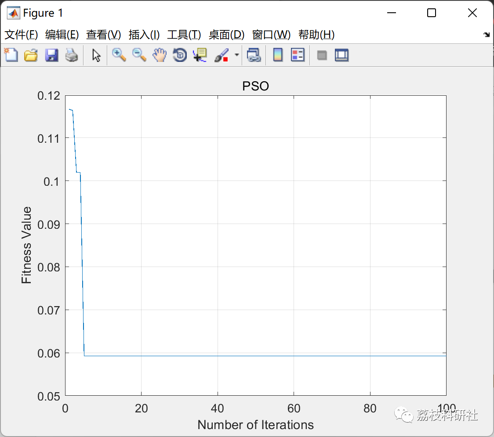
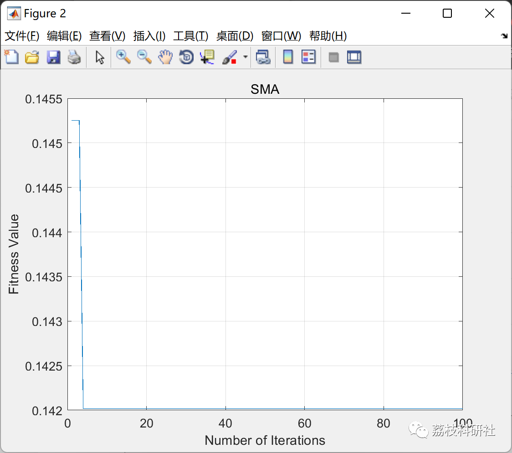
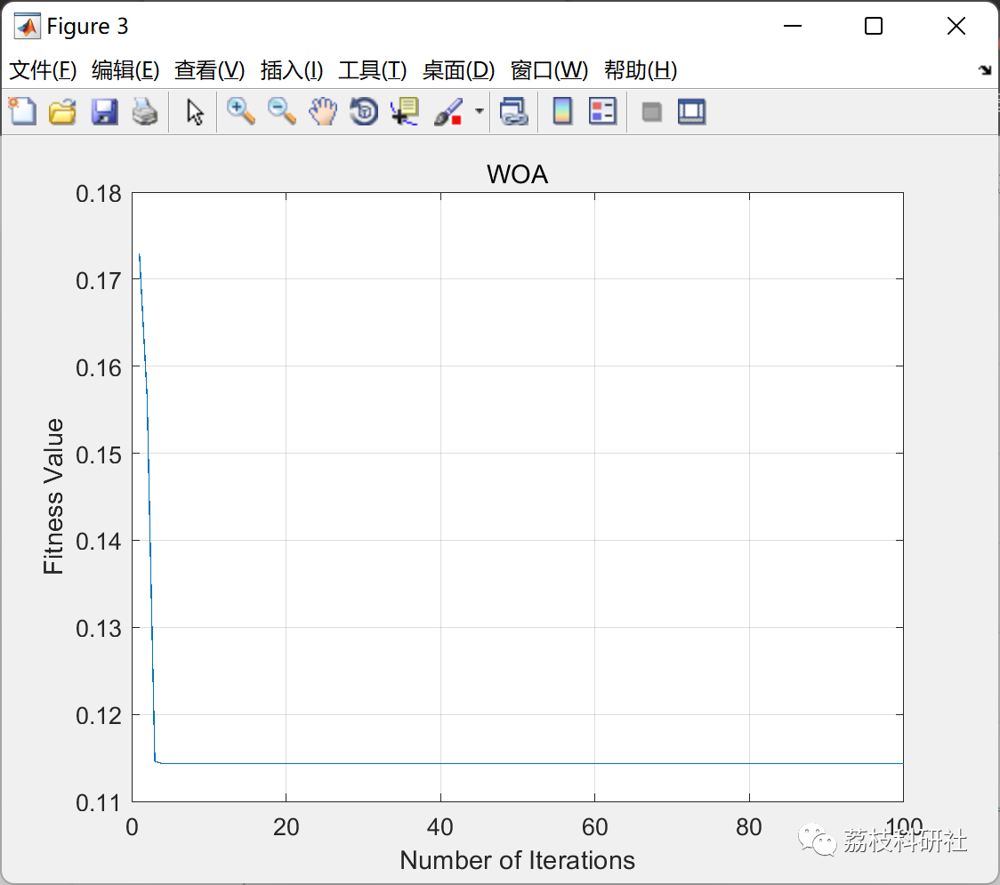

# 40 Various intelligent optimization algorithms including PSO, GA, DE, ACO, GSA, etc. (Matlab code implementation)

💥💥💥💞💞💞 Welcome to this blog❤️❤️❤️ 💥💥💥
🏆 Bloggers' Advantage: 🌞🌞🌞 The content of the blog strives for rigorous thinking and clear logic to facilitate readers.
⛳️ Mantra: "Those who travel a hundred miles may arrive at ninety-nine."
Litchi Research Society
Code Collection: Power Systems, Intelligent Algorithms and Applications, Neural Network Prediction, Path Planning, Optimized Scheduling, Workshop Scheduling, Image Processing, Signal Processing...
🎁 Special Section Links:
🌈🌈🌈🌟🌟🌟🌟 Electric Code Intelligent Algorithms and Their Applications Path Planning Neural Network Prediction Optimized Scheduling Image Processing Workshop Scheduling Signal Processing Romantic Her Thoughts My Philosophy Math Modelling Complete Code Matters
💥1 Overview
This article summarizes 40 total optimization algorithms, then visualizes comparisons using three methods as examples, with the rest simply renaming them. Let's first look at these algorithm summaries:
%---List of available wrapper FS methods------------------------------\n​\n% 2020\n'mpa'       : Marine Predators Algorithm; \n'gndo'      : Generalized Normal Distribution Optimization;\n'sma'       : Slime Mould Algorithm; \n'eo'        : Equilibrium Optimizer;\n'mrfo'      : Manta Ray Foraging Optimization; \n% 2019\n'aso'       : Atom Search Optimization; \n'hho'       : Harris Hawks Optimization; \n'hgso'      : Henry Gas Solubility Optimization; \n'pfa'       : Path Finder Algorithm; \n'pro'       : Poor And Rich Optimization; \n% 2018\n'boa'       : Butterfly Optimization Algorithm;\n'epo'       : Emperor Penguin Optimizer; \n'tga'       : Tree Growth Algorithm; \n% 2017\n'abo'       : Artificial Butterfly Optimization; \n'ssa'       : Salp Swarm Algorithm; \n'sbo'       : Satin Bower Bird Optimization; \n'wsa'       : Weighted Superposition Attraction; \n% 2016\n'ja'        : Jaya Algorithm; \n'csa'       : Crow Search Algorithm;\n'sca'       : Sine Cosine Algorithm; \n'woa'       : Whale Optimization Algorithm;\n% 2015\n'alo'       : Ant Lion Optimizer; \n'hlo'       : Human Learning Optimization; \n'mbo'       : Monarch Butterfly Optimization; \n'mfo'       : Moth Flame Optimization;\n'mvo'       : Multi Verse Optimizer; \n'tsa'       : Tree Seed Algorithm;\n% 2014\n'gwo'       : Grey Wolf Optimizer; \n'sos'       : Symbiotic Organisms Search; \n% 2012\n'fpa'       : Flower Pollination Algorithm;\n'foa'       : Fruit Fly Optimization Algorithm; \n% 2009 - 2010\n'ba'        : Bat Algorithm; \n'fa'        : Firefly Algorithm; \n'cs'        : Cuckoo Search Algorithm; \n'gsa'       : Gravitational Search Algorithm;\n% Traditional\n'abc'       : Artificial Bee Colony; \n'hs'        : Harmony Search;         \n'de'        : Differential Evolution; \n'aco'       : Ant Colony Optimization;\n'acs'       : Ant Colony System; \n'pso'       : Particle Swarm Optimization; \n'gat'       : Genetic Algorithm (Tournament); \n'ga'        : Genetic Algorithm (Roulette Wheel); \n'sa'        : Simulated Annealing;\n​\n​\n​\n  
📚2 Running Results
Then, visualize the comparison of three simple algorithms:
%---Usage-------------------------------------------------------------\n% If you wish to use 'PSO' (see example 1) then you write\n% FS = jfs('pso',feat,label,opts); \n\n%\n If you want to use 'SMA' (see example 2) then you write\n% FS = jfs('sma',feat,label,opts); \n\n%\n * All methods have different calling name (refer List_Method.m file)\n\n​\n%\n---Input-------------------------------------------------------------\n% feat   : Feature vector matrix (Instances x Features)\n% label  : Label matrix (Instances x 1)\n% opts   : Parameter settings \n% opts.N : Number of solutions / population size (* for all methods)\n% opts.T : Maximum number of iterations (* for all methods)\n% opts.k : Number of k in k-nearest neighbor \n\n%\n Some methods have their specific parameters (example: PSO, GA, DE) \n% if you do not set them then they will define as default settings\n% * you may open the < m.file > to view or change the parameters\n% * you may use 'opts' to set the parameters of method (see example 1)\n% * you may also change the < jFitnessFunction.m file >\n\n​\n%\n---Output------------------------------------------------------------\n% FS    : Feature selection model (It contains several results)\n% FS.sf : Index of selected features\n% FS.ff : Selected features\n% FS.nf : Number of selected features\n% FS.c  : Convergence curve\n% Acc   : Accuracy of validation model\n\n​\n%\n% Example 1: Particle Swarm Optimization (PSO) \nclear, clc, close; \n% Number of k in K-nearest neighbor\nopts.k = 5; \n% Ratio of validation data\nho = 0.2; \n% Common parameter settings \nopts.N  = 10; % number of solutions\nopts.T  = 100; % maximum number of iterations\n% Parameters of PSO\nopts.c1 = 2; \nopts.c2 = 2; \nopts.w  = 0.9; \n% Load dataset\nload ionosphere.mat; \n% Divide data into training and validation sets\nHO = cvpartition(label,'HoldOut',ho); \nopts.Model = HO; \n% Perform feature selection \nFS     = jfs('pso',feat,label,opts); \n% Define index of selected features\nsf_idx = FS.sf; \n% Accuracy  \nAcc    = jknn(feat(:,sf_idx),label,opts); \n% Plot convergence\nfigure(1)\nplot(FS.c); grid on; \nxlabel('Number of Iterations'); \nylabel('Fitness Value'); \ntitle('PSO'); \n\n​\n%\n% Example 2: Slime Mould Algorithm (SMA) \n%clear, clc, close; \n% Number of k in K-nearest neighbor\nopts.k = 5; \n% Ratio of validation data\nho = 0.2; \n% Common parameter settings \nopts.N  = 10; % number of solutions\nopts.T  = 100; % maximum number of iterations\n% Load dataset\nload ionosphere.mat; \n% Divide data into training and validation sets\nHO = cvpartition(label,'HoldOut',ho); \nopts.Model = HO; \n% Perform feature selection \nFS     = jfs('sma',feat,label,opts); \n% Define index of selected features\nsf_idx = FS.sf; \n% Accuracy  \nAcc    = jknn(feat(:,sf_idx),label,opts); \n% Plot convergence\nfigure(2)\nplot(FS.c); grid on; \nxlabel('Number of Iterations'); \nylabel('Fitness Value'); \ntitle('SMA'); \n\n​\n%\n% Example 3: Whale Optimization Algorithm (WOA) \n%clear, clc, close; \n% Number of k in K-nearest neighbor\nopts.k = 5; \n% Ratio of validation data\nho = 0.2; \n% Common parameter settings \nopts.N = 10; % number of solutions\nopts.T = 100; % maximum number of iterations\n% Parameter of WOA\nopts.b = 1; \n% Load dataset\nload ionosphere.mat; \n% Divide data into training and validation sets\nHO = cvpartition(label,'HoldOut',ho); \nopts.Model = HO; \n% Perform feature selection \nFS     = jfs('woa',feat,label,opts); \n% Define index of selected features\nsf_idx = FS.sf; \n% Accuracy  \nAcc    = jknn(feat(:,sf_idx),label,opts); \n% Plot convergence\nfigure(3)\nplot(FS.c); grid on; \nxlabel('Number of Iterations'); \nylabel('Fitness Value'); \ntitle('WOA'); 🎉3 References
Optimization Algorithms Summary
🌈4 Matlab Code for Optimization
Click the "Read More" button at the bottom left corner of this article.

## Images

<!-- PAYMENT_BLOCK -->

## Get this dataset

- Payment link (Stripe): [Buy now](https://buy.stripe.com/3cs8yP7sY87d0vu9AB)
- Payment QR code: 

<!-- /PAYMENT_BLOCK -->
